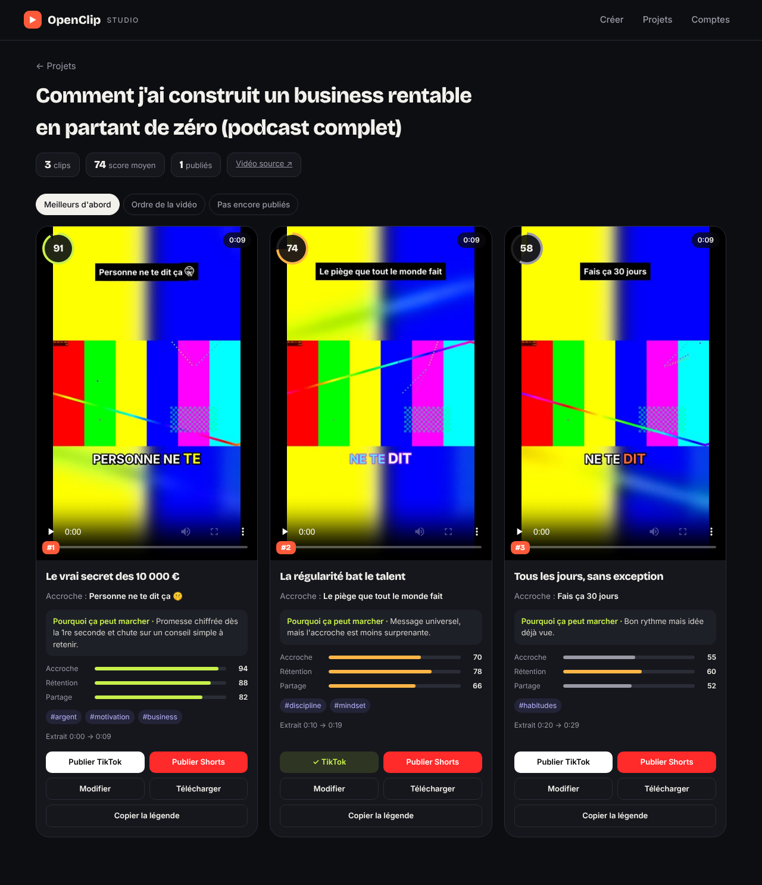

# OpenClip

Colle un lien YouTube et OpenClip produit automatiquement des **clips verticaux de 30 à 60 s**,
sous-titrés façon TikTok, puis peut les **publier sur TikTok et YouTube Shorts**.

```
lien YouTube ─► yt-dlp ─► faster-whisper ─► Claude (meilleurs moments) ─► ffmpeg 9:16 + sous-titres ─► TikTok / Shorts
```



## Fonctionnalités

### Interface web — `openclip web`
- Colle un lien, choisis la durée, le nombre de clips, le cadrage et le style de sous-titres (aperçu en direct)
- Suivi en direct : téléchargement → transcription → analyse IA → montage
- Grille de clips triée par **score viral**, avec le détail **Accroche / Rétention / Partage** et
  « pourquoi ça peut marcher » pour chaque clip
- Éditeur : titre, description, hashtags, accroche à l'écran, mots colorés, style, début/fin (±1 s) → nouveau montage du clip
- Publication TikTok / YouTube en un clic, téléchargement, copie de la légende
- Page Comptes : connexion TikTok depuis le navigateur, connexion YouTube, conseils de monétisation

### Moteur

- Téléchargement de la vidéo (yt-dlp, jusqu'en 1080p)
- Transcription locale au mot près (faster-whisper, langue détectée automatiquement)
- **Analyse locale gratuite** (aucune clé requise) : chaque passage est noté sur l'accroche (question,
  chiffre, phrase choc, adresse directe), la rétention (rythme, blancs, énergie de la voix, fin complète)
  et le partage (émotion, chiffres, rires, sujet précis). Elle écrit aussi l'accroche, le titre, la
  description, les hashtags, les mots à colorer et « pourquoi ça peut marcher ».
- Option : avec une clé Claude, c'est Claude qui choisit les passages et rédige les textes.
- Coupe propre sur les fins de phrases, durée forcée entre `--min` et `--max`
- Recadrage 9:16 : `face` (suit le visage), `center`, ou `blur` (vidéo entière sur fond flou)
- Sous-titres animés en 5 styles (`pop`, `boxed`, `neon`, `karaoke`, `minimal`) : mot prononcé surligné,
  **mots-clés choisis par l'IA en couleur**, accroche animée affichée les 3 premières secondes
- **Suppression automatique des blancs** (jump cuts) pour un rythme plus nerveux
- **Barre de progression** en bas de la vidéo (incite à regarder jusqu'au bout)
- Son normalisé à -14 LUFS (le niveau visé par TikTok / YouTube)
- Publication TikTok via l'API officielle **Content Posting** (post direct ou brouillon)
- Publication YouTube Shorts via l'API YouTube Data v3
- Pas de double publication : chaque envoi est enregistré dans `clips.json`

## Installation

Prérequis : Python 3.10+ et `ffmpeg` (`brew install ffmpeg` / `sudo apt install ffmpeg`).

```bash
python -m venv .venv && source .venv/bin/activate
pip install -e ".[face]"
cp .env.example .env   # puis remplis les clés
```

## Utilisation

### Interface web (recommandé)

```bash
openclip web          # puis ouvre http://127.0.0.1:8000
```

### Ligne de commande

```bash
# 1. Créer des clips (dans output/<id_video>/)
openclip clip "https://www.youtube.com/watch?v=XXXX" -n 5

# 2. Tout en un : clips + publication TikTok et YouTube Shorts
openclip clip "https://youtu.be/XXXX" --upload tiktok,youtube

# Plusieurs liens dans un fichier (un par ligne, # pour commenter)
openclip batch liens.txt --upload tiktok

# Publier plus tard des clips déjà générés (ex. uniquement les clips 1 et 3)
openclip upload output/XXXX --to tiktok --only 1,3

# Options utiles
#   --preset shorts|rewards|long  30-60 s / 62-95 s (TikTok Creator Rewards) / 90-170 s
#   --style pop|boxed|neon|karaoke|minimal
#   --no-jumpcuts --no-bar  garder les blancs / sans barre de progression
#   --min 30 --max 60       durée personnalisée
#   --crop face|center|blur recadrage
#   --lang fr               forcer la langue
#   --no-subs               sans sous-titres
#   --tiktok-mode draft     envoie en brouillon dans l'app TikTok au lieu de publier
#   --privacy SELF_ONLY     confidentialité (YouTube : public|unlisted|private)
```

Chaque dossier `output/<id_video>/` contient les `clip_XX.mp4`, les sous-titres `.ass`
et `clips.json` (titres, descriptions, hashtags, liens de publication). Tu peux modifier les
titres dans `clips.json` avant de lancer `openclip upload`.

## Connecter les comptes

### Claude (optionnel)
Pas obligatoire : sans clé, l'analyse locale gratuite est utilisée. Pour laisser Claude choisir les
passages et rédiger les textes, crée une clé sur <https://console.anthropic.com> (payant à l'usage) et
mets-la dans `ANTHROPIC_API_KEY`. Modèle : `claude-opus-5-5` (modifiable via `OPENCLIP_MODEL`).

### TikTok
1. Crée une app sur <https://developers.tiktok.com>, ajoute les produits **Login Kit** et
   **Content Posting API** (active « Direct Post »), scopes `user.info.basic`, `video.upload`, `video.publish`.
2. Déclare les redirect URI `http://localhost:8000/auth/tiktok/callback` (interface web) et
   `http://localhost:8765/callback` (commande `openclip auth tiktok`).
3. Renseigne `TIKTOK_CLIENT_KEY` et `TIKTOK_CLIENT_SECRET`, puis : `openclip auth tiktok`

> ⚠️ Tant que TikTok n'a pas **audité** ton app, les posts directs sont forcés en **privé**
> (visibles par toi seul). Pour publier en public, demande l'audit dans le portail développeur,
> ou utilise `--tiktok-mode draft` et valide chaque vidéo dans l'app.
> Si TikTok refuse une redirect URI `localhost`, mets une URL https à toi : OpenClip te demandera
> alors de coller l'URL de redirection dans le terminal.

### YouTube Shorts
1. Sur <https://console.cloud.google.com> : crée un projet, active **YouTube Data API v3**,
   crée des identifiants OAuth de type **Application de bureau**, télécharge le JSON en `client_secret.json`.
2. `openclip auth youtube`

> Les projets Google non vérifiés publient en privé et le quota par défaut (10 000 unités/jour)
> permet environ 6 uploads par jour.

Les jetons sont stockés dans `~/.openclip/tokens/` (permissions 600).

## Installer sur ton serveur (à côté d'un site existant)

OpenClip tourne comme un service séparé : ton autre site n'est pas modifié.

```bash
ssh ubuntu@IP_DU_SERVEUR
git clone -b ccr-ed73dc5a-4rh1a8 https://github.com/dev-bye-ai/openclip.git
cd openclip

# Test rapide : http://IP_DU_SERVEUR:8001
sudo bash deploy/install.sh

# Ou sur un sous-domaine en https (créer d'abord un enregistrement DNS A clip.mondomaine.fr -> IP)
sudo bash deploy/install.sh --domain clip.mondomaine.fr
```

Le script installe ffmpeg et Python, crée le service `openclip` (redémarre tout seul), génère un
mot de passe pour l'interface et l'affiche à la fin. Il vérifie que le port est libre, et en mode
sous-domaine il ajoute un bloc dans Caddy (https automatique) ou un site nginx séparé, et remet
l'ancienne configuration si la nouvelle est invalide.

C'est prêt : l'analyse locale fonctionne sans clé. (Optionnel : `ANTHROPIC_API_KEY` dans `.env` puis `sudo systemctl restart openclip`.)

- Logs : `sudo journalctl -u openclip -f`
- Mise à jour : `git pull && sudo bash deploy/install.sh` (avec les mêmes options)
- **Connexion TikTok / YouTube** : les deux plateformes exigent une adresse https avec un nom de
  domaine. Utilise le mode `--domain`, et déclare `https://clip.mondomaine.fr/auth/tiktok/callback` et
  `https://clip.mondomaine.fr/auth/youtube/callback` (client Google de type « Application Web »).
- **YouTube bloque souvent les serveurs** (« confirm you're not a bot ») : dans l'interface, onglet
  **Comptes → Se connecter à YouTube**. Un vrai Chrome s'ouvre sur le serveur, affiché dans la page :
  connecte-toi (idéalement avec un compte Google secondaire), touche « J'ai fini », et OpenClip garde la
  session pour ses téléchargements. « Actualiser » renouvelle les cookies sans se reconnecter.
  Autres options : envoyer un `cookies.txt` exporté depuis un ordinateur, ou envoyer directement le
  fichier vidéo avec « Envoyer un fichier vidéo ».
- **Vitesse** : pour les liens YouTube, OpenClip récupère d'abord les sous-titres automatiques de
  YouTube (quelques secondes) et ne transcrit lui-même que si la vidéo n'en a pas. Pour accélérer la
  transcription locale (fichiers envoyés, vidéos sans sous-titres) : `WHISPER_MODEL=base` ou `tiny`
  dans `.env` (plus rapide, un peu moins précis).

## Mode automatique (onglet « Auto »)

- **Chaînes suivies** : colle le lien d'une chaîne YouTube ; toutes les 20 minutes OpenClip vérifie son
  flux et transforme chaque nouvelle vidéo en clips (les vidéos déjà en ligne sont ignorées).
- **File d'attente** : les clips au-dessus du score minimum y entrent, meilleurs d'abord. « Ajouter à la
  file auto » sur un projet y met aussi ses clips.
- **Heures de publication** : à chaque créneau (ex. 12:00, 18:00, 21:00, heure de Paris), le meilleur clip
  en attente est publié sur TikTok et/ou YouTube Shorts (comptes connectés dans Comptes).
- Désactivable à tout moment ; `OPENCLIP_SCHEDULER=0` coupe complètement la boucle de fond.

Pour publier **sans aucune intervention**, les applications TikTok et Google doivent être validées par
ces plateformes : avant, TikTok publie en privé (ou en brouillon) et YouTube en privé.

## Automatisation par cron (ancienne méthode)

Pour que ça tourne tout seul, ajoute tes liens dans `liens.txt` et programme une tâche cron :

```cron
0 */6 * * * cd /chemin/openclip && .venv/bin/openclip batch liens.txt --upload tiktok,youtube
```

Les vidéos déjà traitées réutilisent leur transcription en cache et les clips déjà publiés sont ignorés.

## Gagner de l'argent avec ses clips

- **TikTok Creator Rewards** ne rémunère que les vidéos de **plus d'1 minute** et le contenu **original** :
  utilise `--preset rewards` (62-95 s) et apporte ta valeur (angle, commentaire, montage).
- **YouTube Shorts** partage les revenus publicitaires une fois le Programme Partenaire atteint ; les
  re-uploads sans transformation sont classés « contenu réutilisé » et non monétisés.
- Beaucoup de streamers et podcasteurs paient des **clippeurs à la vue** : c'est souvent la façon la plus
  directe de rentabiliser ce type d'outil, et tu as l'autorisation de publier.
- Publie régulièrement, une thématique par compte, et compare les scores d'accroche avec tes vraies vues.

## Droits d'auteur

Ne publie que des clips de vidéos dont tu détiens les droits ou pour lesquelles tu as l'autorisation
du créateur. OpenClip ajoute automatiquement un crédit vers la vidéo source dans la description.

## Tests

```bash
pip install -e ".[dev]" && pytest
```
